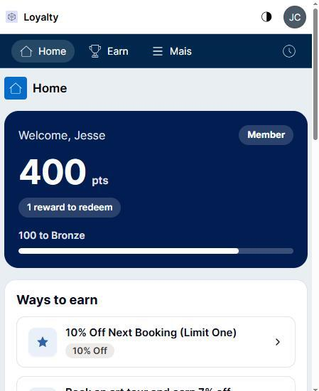
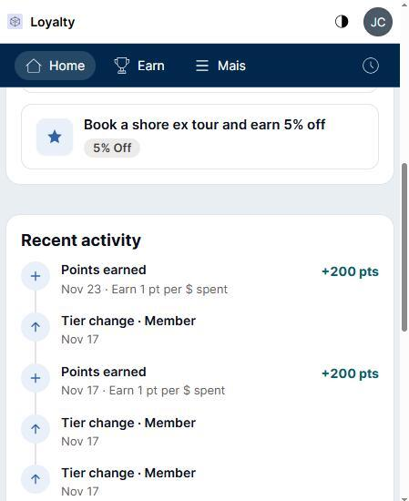
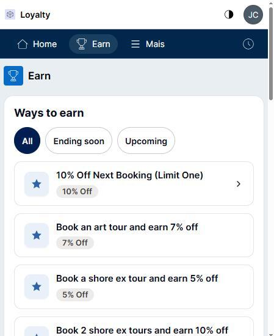
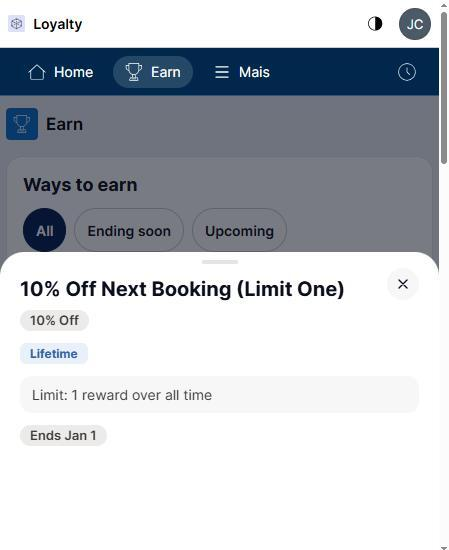
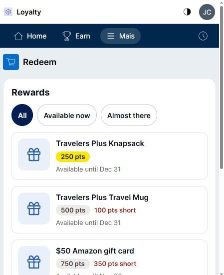
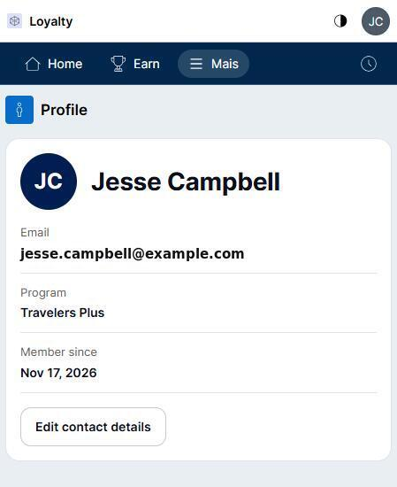
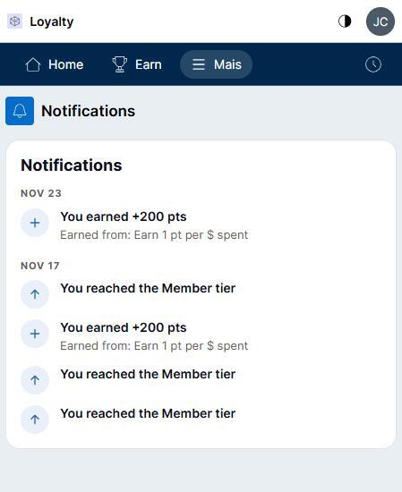

The member portal gives your members one place to see their balance and tier, find ways to earn, redeem rewards and track their activity. Everything they see is driven by your program configuration, so changes to incentives, rewards and segments show up without any extra work.

The portal is built for phones first. Members move between **Home**, **Earn** and a **More** menu that holds **Redeem**, **Profile** and **Notifications**.

## Home

Home is the member's dashboard. It shows their current balance and tier, and highlights the incentives and rewards most relevant to them.

<Frame>
  
</Frame>

### Recent activity

Below the highlights, members see their latest ledger activity, so they can confirm that points from a purchase or activity have been credited.

<Frame>
  
</Frame>

## Earn

The Earn page lists every incentive available to the member, based on their segments. Members can filter the list by **All**, **Ending soon** or **Upcoming**.

<Frame>
  
</Frame>

Selecting an incentive shows what the member will earn and any eligibility details.

<Frame>
  
</Frame>

## Redeem

The Redeem page is the rewards catalog. Each reward shows its price and availability. Members can filter by **All**, **Available now** or **Almost there**, and for rewards they can't yet afford, the portal shows how many points they are short.

<Frame>
  
</Frame>

## Profile

Members can review their name, email, program and member-since date, and update their contact details with **Edit contact details**.

<Frame>
  
</Frame>

## Notifications

Notifications keep members informed about points earned, rewards and other program updates in one place.

<Frame>
  
</Frame>

## Build your own member experience

Prefer to surface loyalty data in your own app, website or storefront? Everything in the portal is available through the [Fielo Loyalty API](/api-reference), so you can embed the same experience on the touchpoints your members already use.
